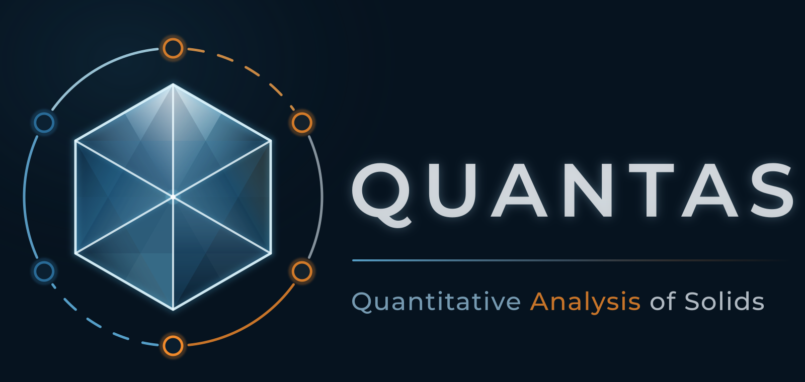

# Quantas

<p align="center"></p>

[](https://github.com/gfulian/quantas/actions/workflows/ci.yml)
[](https://quantas.readthedocs.io/en/2.0.0-beta/)
[](https://quantas.readthedocs.io/en/2.0.0-beta/)
[](https://www.python.org/downloads/)
[](LICENSE)

Quantas is an open-source scientific toolkit for the quantitative analysis of
solid-state properties. It was created to make demanding thermodynamic,
elastic, seismic, and equation-of-state calculations easier to perform,
inspect, reproduce, and reuse.

The code was redesigned from its original implementation (v0.9.1) as a reusable 
scientific library, where the same numerical implementation are used by the Python 
API and the command-line interface, and are intended to support other frontends 
without duplicating scientific logic.

> **Quantas 2 is currently in beta.**
>
> The main scientific workflows are extensively tested and are already being
> used for research calculations. The public API, file schemas, interfaces, and
> documentation may nevertheless receive further changes before the first
> stable 2.0 release.

A graphical user interface is in active development, and it will be provided as
a separate package.

## Scientific capabilities

Quantas currently provides workflows for:

- harmonic and quasi-harmonic thermodynamics;
- Kieffer acoustic thermodynamics for suitable Gamma-point phonon calculations;
- second-order elasticity, mechanical stability, Voigt-Reuss-Hill averages,
  tensor rotations, and directional elastic properties;
- Christoffel analysis, phase and group velocities, polarization, anisotropy,
  and seismic surfaces;
- pressure-volume, energy-volume, volume-temperature, and coupled
  pressure-volume-temperature equations of state;
- quasi-static thermoelastic properties as functions of pressure and
  temperature, including geological-profile calculations.

The scientific workflows can be used from the command line or through the
public `quantas.api` Python interface.

Quantas also provides interfaces for reading and normalising data produced by
electronic-structure and lattice-dynamics codes. Current support includes
CRYSTAL and VASP workflows, with code-specific parsing kept separate from the
scientific models.

Results from the main workflows are stored in self-describing HDF5 archives.
These archives retain numerical results together with units, calculation
options, provenance, warnings, diagnostics, and other information required to
understand how a result was obtained.

## Requirements and installation

Quantas currently supports Python 3.10 through 3.13. Python 3.14 is not yet 
supported because the complete scientific dependency stack has not been validated 
on that runtime.

The current Quantas 2 beta can be installed directly from the GitHub
repository:

```bash
git clone https://github.com/gfulian/quantas.git
cd quantas
python -m pip install .
```

Installation inside a dedicated virtual environment is recommended.

Optional plotting support can be installed with:

```bash
python -m pip install ".[plot]"
```

For development work, install the complete development dependency set instead:

```bash
python -m pip install ".[dev]"
```

Development builds and feature branches may change more frequently than the
current master branch. Contributors should refer to
[CONTRIBUTING.md](CONTRIBUTING.md) and [DEVELOPMENT.md](DEVELOPMENT.md) before
starting new work.

## Documentation

The Quantas documentation contains installation guidance, scientific
background, tutorials, command-line reference, Python API documentation,
input-format descriptions, interoperability examples, and validation material.

[Read the Quantas 2.0 beta documentation](https://quantas.readthedocs.io/en/2.0.0-beta/)

Documentation for the historical Quantas 0.9.1 release remains available
through the Read the Docs version selector.

## Scientific reliability

Quantas is developed as scientific software. Changes to formulas, numerical
methods, units, tensor conventions, or data interpretation are treated
separately from presentation and structural cleanup.

Numerical changes are characterised with tests and, where possible, compared
against analytical results, legacy behaviour, published data, or independent
implementations before they are accepted.

Native calculations use double precision: real-valued scientific data are
stored as `float64`, and complex-valued data as `complex128`. Display precision
is handled separately and does not alter stored results.

## Citation

Quantas is an academic, open-source software. If you use it in published work,
please cite Quantas together with the scientific methods relevant to the
calculation that was performed.

The canonical software citation is provided in [CITATION.cff](CITATION.cff). 
Method-specific references are also included in the documentation and in the 
internal citation registry used by Quantas reports.


## Contributing and license

Contributions, bug reports, validation datasets, comparisons with independent
implementations, and documentation improvements are welcome.

See [CONTRIBUTING.md](CONTRIBUTING.md) for contribution guidelines and
[DEVELOPMENT.md](DEVELOPMENT.md) for the development and branch workflow.

Planned scientific and engineering work is summarised in
[ROADMAP.md](ROADMAP.md).

Quantas is distributed under the BSD 3-Clause license. See [LICENSE](LICENSE).
